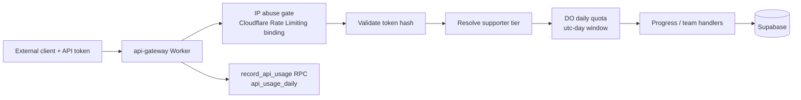

# Gateway rate limiting

How the `api-gateway` Worker limits token-authenticated clients. Client-facing quotas and headers:
[api.md](./api.md#rate-limits). App mutation limits, Pages/Nitro limits, account deletion and
Supabase Auth limits belong to TarkovTracker
([ownership map](https://github.com/tarkovtracker-org/TarkovTracker/blob/main/docs/rate-limiting.md)).

## Controls

- **Abuse gate.** `API_ABUSE_LIMITER` (`[[ratelimits]]` in `wrangler.toml`, 300 requests per
  60 seconds) keyed `api:<CF-Connecting-IP>`, before token lookup. Per-location and eventually
  consistent; it shields `api_tokens` and Supabase from floods. `period` must equal
  `ABUSE_GATE_PERIOD_SEC` in `src/limits.ts`.
- **Daily quota.** One `ApiGatewayRateLimiter` Durable Object call per request, keyed
  `daily-read:<userId>` or `daily-write:<userId>`, UTC-day window, retained state. Limits are
  `TIER_LIMITS` in `src/limits.ts`. A unit is consumed when an authenticated request is admitted;
  downstream failures are not refunded. There is no burst bucket, IP backstop or refund
  reconciliation; reintroducing any of them is a regression.
- **Usage accounting.** `record_api_usage` writes `public.api_usage_daily` off the response path.
  It is observability, not a limiter.
- **Shared namespace.** TarkovTracker Pages binds the same DO class through
  `script_name = "api-gateway"` for its own ephemeral limiter keys. Its protocol is pinned by
  `src/__tests__/pages-limiter-contract.test.ts`.

## Fail behavior

| Control     | On failure                                                                                                                 |
| ----------- | -------------------------------------------------------------------------------------------------------------------------- |
| Abuse gate  | Fails open; logs `abuse_gate_unavailable`.                                                                                 |
| Daily quota | Fails open (product entitlement, not a DB-integrity boundary); logs `daily_quota_unavailable`; no `X-RateLimit-*` headers. |

Neither failure is recorded as a throttle in `api_usage_daily`. Do not change a control's fail
mode without weighing its abuse impact.

## Observability

The Worker logs structured `daily_quota_429` (identifies `user_id`, `token_id`) and
`abuse_gate_429` (identifies `ip_hash`, a truncated HMAC-SHA-256 of the client IP keyed by
`IP_HASH_SECRET`; never the raw IP). In Workers Logs Query Builder, use **Last 24 hours**,
**Count**, sorted descending:

| Purpose                               | Filters                                                                   | Group by              |
| ------------------------------------- | ------------------------------------------------------------------------- | --------------------- |
| Daily quota denials by user           | `event` equals `daily_quota_429`                                          | `user_id`             |
| Daily quota denials by user and token | `event` equals `daily_quota_429`                                          | `user_id`, `token_id` |
| Abuse-gate denials by hashed IP       | `event` equals `abuse_gate_429`; `ip_hash` matches Regex `^[0-9a-f]{16}$` | `ip_hash`             |

Do not generate load by deliberately triggering denials. TarkovTracker's admin
`GET /api/admin/api-usage` reports top consumers from `api_usage_daily`. Logpush, WAF
verification and alerting are open work.

## Retention

| Store                   | Retention                                                                              |
| ----------------------- | -------------------------------------------------------------------------------------- |
| DO ephemeral keys       | Self-clean with alarms at `resetAt + 1s` (Pages keys).                                 |
| DO retained keys        | Expire by window logic.                                                                |
| Legacy burst/IP DO keys | Orphaned by the daily-quota refactor (no cleanup alarms); staged cleanup is open work. |
| `api_usage_daily`       | 180 days, nightly pg_cron job owned by TarkovTracker `supabase/`.                      |
